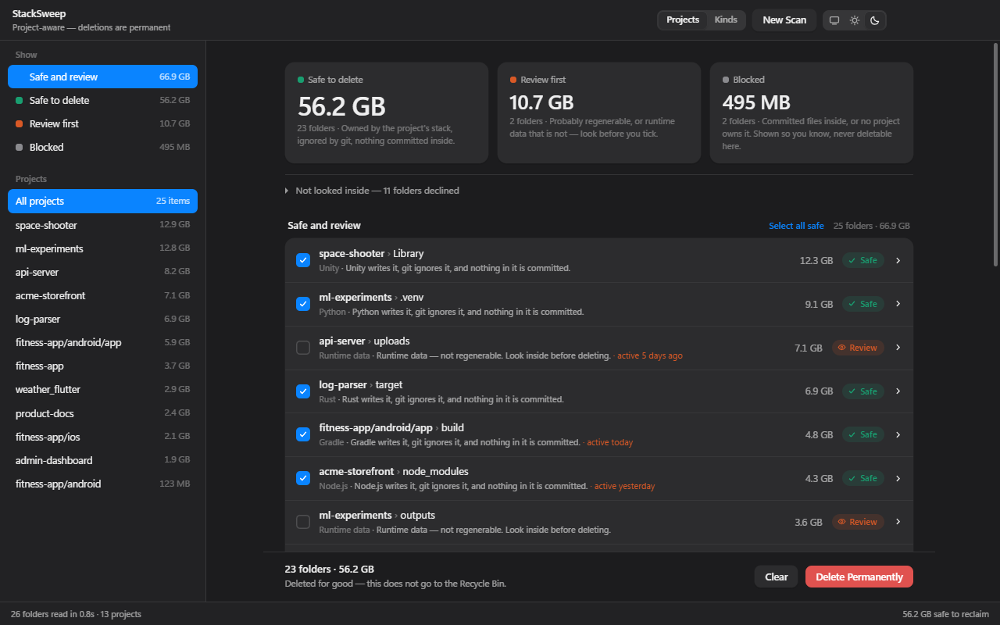
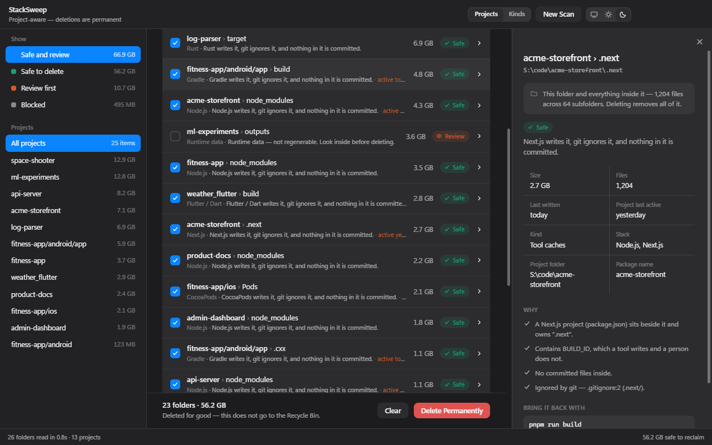
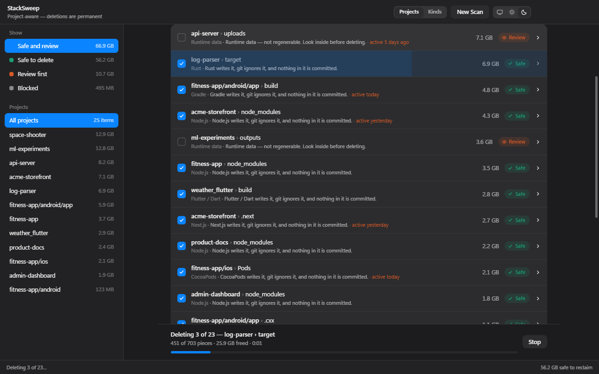

<p align="center"></p>

<h1 align="center">StackSweep</h1>

<p align="center"><b>Delete node_modules, build folders and dev caches on Windows — safely.</b><br/>
Free up gigabytes of disk space from <code>node_modules</code>, <code>.next</code>, <code>dist</code>, <code>build</code>, Gradle, Rust <code>target</code>, Python <code>.venv</code> and more.</p>

<p align="center">
  <a href="../../releases/latest"><b>Download for Windows</b></a> ·
  <a href="#faq">FAQ</a> ·
  <a href="docs/how-it-works.md">How it works</a>
</p>

---

StackSweep is a free, open-source Windows app for developers whose disk is full of
old project dependencies and build output. Point it at a folder or a whole drive:
it finds every project, recognises its **stack** (Node.js, Next.js, Gradle, Rust,
Python, .NET, Flutter…), and offers to delete only the folders that stack
regenerates. Your source code, committed files, SDKs and installed apps are never
touched.

On a busy developer drive it typically finds tens of gigabytes, and a whole drive scans in under a minute.

<p align="center">
  
</p>

<table>
  <tr>
    <td width="50%"></td>
    <td width="50%"></td>
  </tr>
  <tr>
    <td align="center"><sub>Every finding shows the evidence behind it</sub></td>
    <td align="center"><sub>Live progress while deleting, with a Stop button</sub></td>
  </tr>
</table>

<sub>Screenshots use a demo folder of sample projects.</sub>

## What it cleans

| Stack | Folders it can remove |
| --- | --- |
| Node.js (npm, pnpm, yarn, bun) | `node_modules`, and `dist` / `build` / `out` when your build tool writes them, `.turbo`, `.parcel-cache`, `.vite`, `coverage` |
| Next.js · Nuxt · SvelteKit · Astro · Angular · Gatsby · Docusaurus | `.next`, `.nuxt`, `.output`, `.svelte-kit`, `.astro`, `.angular`, `.cache`, `.docusaurus` |
| React Native · Expo · Android (Gradle) | `.expo`, `android/app/build`, `android/build`, `.gradle`, `.cxx` |
| iOS (CocoaPods) | `Pods`, `build` |
| Rust | `target` |
| Python | `.venv`, `venv`, `__pycache__`, `.pytest_cache`, `.mypy_cache`, `.ruff_cache`, `.tox`, `build`, `dist` |
| Java (Maven) | `target` |
| .NET / C# | `bin`, `obj` |
| Flutter / Dart | `build`, `.dart_tool` |
| PHP (Composer) · Ruby (Bundler) | `vendor` |
| C / C++ (CMake) | `build`, `cmake-build-*` |
| Unity · Godot | `Library`, `Temp`, `Obj`, `Logs`, `.godot` |
| Swift · Zig · Elixir · Haskell | `.build`, `zig-out`, `.zig-cache`, `_build`, `deps`, `.stack-work` |

It can also point out large **runtime data** inside projects (gitignored
`uploads`, `logs`, `tmp`, `renders`, `output`…). These are marked *Review* and are
never pre-selected, because unlike build output they do not come back.

## Why it is safe

A folder called `build` is not junk because of its name. StackSweep only offers it
when the evidence agrees:

- **The project's stack owns it.** `dist` is only offered when Vite, webpack,
  Rollup or another tool in that project writes `dist`.
- **Nothing in it is committed to git.** A `dist` with committed files is source,
  whatever it is called. It is shown as *Blocked*.
- **Git ignores it, or it carries a marker only a tool writes**, such as
  `.package-lock.json`, `CACHEDIR.TAG`, `pyvenv.cfg` or `BUILD_ID`.
- **SDKs and installed software are skipped**: `AppData`, Program Files, VS Code
  and Cursor extensions, packaged Electron apps, emsdk, nvm, the Android SDK,
  global npm packages.
- **It checks again right before deleting.** If a file inside was committed in the
  meantime, the folder is left alone.

Every finding is marked **Safe**, **Review** or **Blocked**, with the evidence
behind it and the command that brings it back (`npm install`, `cargo build`…).

## Features

- Scan any folder or entire drives
- Groups results by project or by kind (dependencies, build output, caches, native builds, venvs)
- "Select all safe" in one click, with sizes and the last time each project was touched
- Handles locked folders and very long Windows paths, and tells you when a dev server or IDE is holding files open
- Offline: no AI, no network, no telemetry
- Light and dark mode

> **Deletion is permanent.** Files do not go to the Recycle Bin. Nothing is
> deleted until you tick it and confirm.

## Download

Download the latest installer from **[Releases](../../releases/latest)**
(`StackSweep-Setup-x.y.z.exe`). Every push also builds one, available from
[Actions](../../actions).

Git should be installed and on `PATH`. StackSweep uses it to tell committed files
from build output; without it, most findings are marked *Review* instead of
*Safe*.

## FAQ

<details>
<summary><b>How do I delete all node_modules folders on Windows?</b></summary>

Open StackSweep, choose the folder that holds your projects (or tick a whole
drive), click **Scan**, then **Select all safe** and **Delete Permanently**. It
removes every `node_modules` at once, including the nested ones, and it also finds
`.next`, `dist`, `build` and other caches you may have forgotten.
</details>

<details>
<summary><b>Is it safe to delete node_modules, .next, dist or build?</b></summary>

Yes, if they are generated output. `npm install` (or pnpm/yarn) restores
`node_modules`, and your next build recreates `.next`, `dist` or `build`. The risk
is a folder that only *looks* generated: a `dist` with committed files, or a
`build` that is really source. StackSweep checks git and the project's tooling and
blocks those.
</details>

<details>
<summary><b>Why can't I delete node_modules? ("file in use", "access denied", "path too long")</b></summary>

Usually a dev server, an IDE, an emulator or a file watcher still has files open,
or the path is longer than Explorer can handle. StackSweep deletes long paths
without trouble, retries brief locks, and if a folder is still locked it says so
in red so you know to close the dev server or IDE and try again.
</details>

<details>
<summary><b>How can I free up disk space as a developer?</b></summary>

Dependencies and build caches from old projects are usually the biggest win:
`node_modules`, `.next`, Gradle `build` and `.gradle`, Rust `target`, Python
virtual environments and Android `.cxx` folders often add up to tens of gigabytes.
Scan your code folder with StackSweep to see exactly how much each project uses.
</details>

<details>
<summary><b>How do I clean Gradle / Android Studio build folders?</b></summary>

StackSweep recognises every Gradle module (`build.gradle` or `build.gradle.kts`)
and offers its `build`, `.gradle` and `.cxx` folders, including those inside
React Native and Flutter projects. The global Gradle cache in your user folder is
left alone.
</details>

<details>
<summary><b>How do I delete Rust target folders or Python venvs?</b></summary>

Rust `target` folders are found next to `Cargo.toml` and confirmed by their
`CACHEDIR.TAG`. Python `.venv`/`venv` folders are confirmed by `pyvenv.cfg`, and
scattered `__pycache__` folders are gathered into one row per project.
</details>

<details>
<summary><b>Will it delete my source code or anything committed to git?</b></summary>

No. Any folder with committed files inside is *Blocked* and cannot be selected.
That is checked during the scan and again right before deleting.
</details>

<details>
<summary><b>Does it move files to the Recycle Bin?</b></summary>

No, deletion is permanent. Sending hundreds of thousands of small files to the
Recycle Bin is extremely slow and often fails, and everything StackSweep offers
can be rebuilt. The confirmation dialog says this up front.
</details>

<details>
<summary><b>Does it send any data anywhere?</b></summary>

No. It works fully offline: no AI, no network requests, no telemetry.
</details>

<details>
<summary><b>Is this an npkill alternative?</b></summary>

Yes. StackSweep is a Windows desktop app rather than a terminal tool, it covers
many stacks beyond Node.js, and it checks git and each project's tooling before
offering a folder.
</details>

<details>
<summary><b>Does it work on macOS or Linux?</b></summary>

No, StackSweep is Windows only.
</details>

## Build from source

```sh
npm install
npm start        # run the app
npm run check    # offline self-check
npm run scan -- "D:\code"   # dry run in the terminal, deletes nothing
npm run dist     # build the installer into release/
```

Requires Node.js 20+. The design and the safety rules are documented in
[docs/how-it-works.md](docs/how-it-works.md).

## License

[MIT](LICENSE) © mehrabsha
